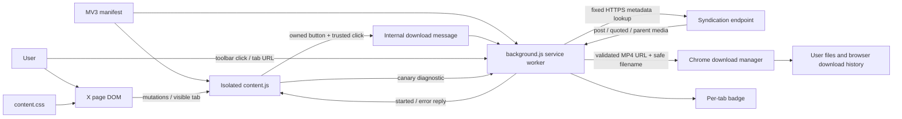
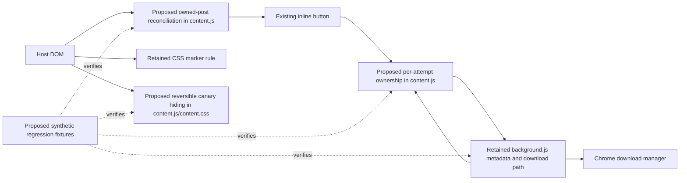

# Repository audit and improvement plan

Audit date: **2026-09-08 (Europe/Warsaw)**. Inspected baseline: `main` at `8569aa44ff01de50ea656dec2120fc649bb15b14`, initially clean. Sections 1–11 preserve the baseline assessment and its source locations.

**Subsequent authorized remediation:** the user requested “fix all findings”. All six registered findings are now addressed in the local 3.6.1 working tree, with 23 passing regression tests, lint and formatting checks. See [REMEDIATION.md](REMEDIATION.md) for current file locations, the patch, test evidence and remaining native-browser gaps. No remote changes were made.

## 1. Executive Summary

**Keep the existing extension and make targeted fixes.** Its small Manifest V3 architecture fits its documented purpose: individual Chromium users download exposed MP4 videos and hide ads on x.com, without a backend, popup, settings, build step, or runtime dependencies. The content-script/service-worker boundary is appropriate, and the download path contains useful input, filename, URL and error-handling guards. These conclusions are limited to the inspected implementation and synthetic checks (`README.md:3-7,14-26,36-49`; `manifest.json:21-33`; `background.js:35-53,89-191`; D009).

The principal weakness is **DOM and asynchronous state consistency**. Four bounded correctness defects were reproduced against unchanged source in a controlled DOM model:

| Priority | Finding | Consequence |
| --- | --- | --- |
| P2 | F-001: late response accepted during a retry | An older request can display success and suppress the newer request's failure. |
| P2, conditional on node retention | F-002: button keeps its original post ID | A retained button can request a different post from the one currently displayed. |
| P2, conditional on cell reuse | F-003: fallback ad hiding is never reversed | An organic post replacing an ad can remain invisible until the page/cell is recreated. |
| P2, conditional on partial rendering | F-004: outer post selects a nested action bar | Incorrectly bound buttons accumulate in the quoted post's controls. |
| P2 | F-005: no retained behavioral regression suite | Existing lint/format gates accept all four demonstrated cases. |
| P2 | F-006: unsupported developer tooling | CI uses upstream-EOL Node 20; locked ESLint 9 is also upstream EOL; the declared Node minimum is broader than the linter supports. |

The first four findings have strong static and model evidence; **their frequency on the current X UI was not established**. No credible P0/P1 emergency or exposed credential was found within the methods used. No containment action is proposed as an emergency, and absence of a finding is not a security guarantee.

Lint, formatting and JavaScript syntax checks pass on the disposable unchanged snapshot. Eleven background scenarios pass; seven DOM-model scenarios pass and four regression assertions fail. These are **22 audit scenarios, not code-coverage measurements or live end-to-end tests**. Chromium timed out on both the fixture and a separate blank-page diagnostic, so real extension installation, current X selectors/metadata, browser downloads, Save As and accessibility remain unverified (D006-D015).

The supported plan is to retain the architecture, preserve behavioral fixtures, repair request/post/cell ownership, and align development tooling with supported releases. Another rewrite would expose already-working media selection, permissions, filenames and fallback behavior to unnecessary parity risk. Overall health is **mixed within inspected scope**: compact and understandable, with material, localized correctness and regression-protection gaps.

## 2. Audit Scope & Provenance

### Baseline and write boundary

| Item | Recorded state / evidence |
| --- | --- |
| Repository root | `/home/adam/projects/xvid` (B001/B003) |
| Branch / commit | `main` / `8569aa44ff01de50ea656dec2120fc649bb15b14` (B003/B006) |
| Initial worktree | Clean: no staged, unstaged or untracked changes; no relevant uncommitted application work (B002/B008) |
| History | Not shallow; 62 commits reachable from HEAD. Remote freshness and unreachable objects unverified (B003/C006/C010). |
| Inspected copy | All 31 tracked files copied byte-for-byte to `/tmp/xvid-audit-kyq46bbr`; [baseline-manifest.json](baseline-manifest.json) records their SHA-256 hashes and sizes (B012). |
| Output boundary | This new unique directory, `audit-output/2026-09-08-8569aa4-gdx8bvb7`. It did not overwrite pre-existing audit work. |
| Audit-phase application state | V001 verifies all baseline tracked files unchanged at the start of the newly authorized remediation. The later remediated working tree is separately fingerprinted in REMEDIATION.md and V002. |

B003's combined `git rev-parse` invocation returned branch/history information but did not print the SHA; B006 corrected that evidence gap. A commit identifier is sufficient here only together with the recorded initially clean status and file-hash checks.

The audit contract superseded repository session instructions to push, pull/rebase, synchronize beads, commit, clear stashes or prune branches. None was performed. `bd onboard` and `bd prime` were attempted in the disposable copy and failed because bd is absent (B013/B014). Issue state was not modified. Application code/configuration remained unchanged during the audit phase; later changes explicitly authorized by the user are recorded separately in REMEDIATION.md.

### Capabilities and methods

Filesystem/network access was technically available, constrained by the user's audit-only boundary. Tools verified: Linux x86_64/glibc 2.39, Git 2.43.0, Python 3.12.3, Node 24.20.0 and Chrome for Testing 152.0.7977.64 (B011/C004). No user-specified resource budget; no sub-agents. Commands used finite known inputs or explicit deadlines.

npm was initially absent. Audit-only npm 12.0.2 was acquired from the public registry with tarball SHA-512 verification, then used with separate empty configs, isolated cache, disabled lifecycle scripts and disabled automatic audit/funding traffic. D003's config-path collision was an audit setup error, corrected in D005; it was not a repository defect. The exact lock installed successfully. jsdom 30.0.1 was later installed **outside the snapshot** solely for model checks; its installed versions and hidden lock are preserved as artifacts (D001-D005/D013-D014/C014).

The network namespace attempt failed (C008). Browser attempts used fresh disposable profiles, blocked DNS, a loopback proxy sink, disabled background networking and a local restrictive-CSP fixture. D010 and D012 timed out; no native browser result is claimed. The fallback DOM model disables resource loading and stubs extension APIs; its explicit offsetParent shim models only display:none ancestry. Real layout, trusted input, isolation and worker lifetime remain outside that evidence.

External traffic was limited to primary documentation and public package metadata/tarballs/advisories. Only public dependency names and versions were submitted to the npm advisory service; no repository source, root package metadata, credentials or user content was transmitted. No X, syndication, CDN media or production endpoint was contacted. No real profile, database or download was used.

### Component coverage ledger

| Component | Inventory/search | Read/traced | Runtime verification | Exclusion / unfinished work |
| --- | --- | --- | --- | --- |
| `manifest.json` | Complete | All 35 lines; runtime registrations and privileges | None as an installed extension | Actual permission grants, action activation, minimum-browser behavior |
| `background.js` | Complete | All 205 lines; both entry paths to lookup/download/error | D009: eleven stubbed scenarios | Live provider schema/availability, Chrome downloads, Save As, worker suspension |
| `content.js` | Complete | All 252 lines; observer, ownership, click/reply and ad lifecycle | D015: seven model passes, four failures | Current X DOM, actual visibility/input/accessibility and Chromium |
| `content.css` | Complete | All 56 lines; button states, timeline/sidebar ad scope | CSS model only in D015 | Native rendering, contrast, layout cost and current marker accuracy |
| Package/lock/lint/format/CI | Complete | Scripts, engines, resolved metadata, triggers read | D005-D008 baseline gates | Exact CI Node 20 execution, remote branch protections/check results |
| README/contribution/changelog/license/agent docs | Complete | Product promises, setup, releases and conventions read | Tooling setup/gates checked | Local installation and real manual smoke checklist |
| `icons/` | Complete | PNG header/dimensions only | None | Visual review excluded; low architectural centrality |
| `.beads/`, `.claude/` | Complete inventory; metadata keys/status counts, secret search | Beads config/hooks read; issue bodies/automation not deeply reviewed | bd unavailable; hooks never run | Task history correctness and local automation intentionally excluded |
| Git history | Local refs inventoried/searched | Commit signals, removed-test provenance; heuristic text-blob scan | None | Historical code is not end-to-end audited; remote freshness unknown |
| Generated/vendor/audit data | Separately identified | Lock metadata only; runtime dependencies absent | Audit tools used as stated | Dependency implementation and binary internals not audited |

Inventory/search coverage is not end-to-end review. All **current runtime source** was read, but its browser/provider integrations remain only partially verified.

## 3. Project Understanding

### Purpose, requirements and vocabulary

Documented requirements are: x.com-only activation; inline and toolbar downloads; highest-quality exposed MP4 selection; all supported media in multi-video posts; Alt/Option-click Save As; top-level media with quoted/parent fallback; promoted-post hiding and an ad-marker canary (`README.md:3-28,54-60`). Deliberate constraints are no popup/settings/build/runtime dependencies and minimal permissions (`CONTRIBUTING.md:15-20`; `CLAUDE.md:69-89`).

“Tweet” in identifiers means an X post. A **tweet block** is a DOM element with `data-testid="tweet"`; an **action bar** is a descendant role=group; a **cell** is a timeline container; **media variants** are provider alternatives ranked by bitrate, then encoded resolution. **Canary rot** means an English-labeled ad is visible despite the structural CSS marker (`content.js:4-8,24-40,97-131`; `background.js:156-190`).

The expected invariant that a control belongs to its currently displayed post, and that organic replacement content should remain visible, is inferred from those user-facing promises. Exact X DOM retention/rendering behavior is not supplied. User volume, browser support beyond the declared minimum, locales, enterprise/store distribution, accessibility requirements and product service levels are unknown.

### Stack and significant tree

```text
xvid/
├── manifest.json              MV3 registrations, hosts, permissions; minimum Chrome 105
├── background.js              event-driven service worker: metadata and download requests
├── content.js                 isolated page script: DOM discovery, controls, feedback, canary
├── content.css                controls and structural ad hiding
├── icons/                     three PNG action/extension icons
├── package.json / package-lock.json
│                              npm development tools only; no extension build
├── eslint.config.mjs / .prettierrc / .prettierignore
├── .github/workflows/lint.yml  main push/PR lint and format checks
├── README.md / CONTRIBUTING.md / CHANGELOG.md / LICENSE
├── AGENTS.md / CLAUDE.md       local contributor/agent workflow guidance
├── .beads/{config.yaml,issues.jsonl,hooks/,...}
│                              issue-tracker data and hook sources
└── .claude/settings.json       local automation metadata (limited review)
```

The audit-output directory is new and excluded from this baseline inventory. Runtime languages are classic JavaScript plus CSS and JSON. Development tools use Node/npm, ESLint flat ESM configuration and Prettier. There is no application server, frontend framework, database, migration, queue, worker fleet, scheduler, bundler or infrastructure deployment definition in the tracked baseline (B007/C001-C007/C013). The browser service worker is an extension event handler, not a backend service.

Entrypoints are manifest content-script registration at document_idle in ISOLATED world, background service-worker loading, runtime onInstalled/onMessage, toolbar onClicked, document click/visibilitychange and MutationObserver callbacks (`manifest.json:23-33`; `background.js:12-70`; `content.js:191-252`).

### Configuration, entities and boundaries

The manifest is the deployment/permission configuration. Runtime constants include the 12-second metadata deadline, 5–25-digit request IDs, 200 ms sweep spacing, five-second canary spacing and English ad labels; there is no runtime environment-variable or persisted-settings loading (`background.js:1-10,89-95`; `content.js:4-17,104-111`; C013). Beads hooks read `BEADS_HOOK_TIMEOUT` and export `BD_GIT_HOOK`; these are developer workflow variables, not application configuration (`.beads/hooks/pre-commit:4-15`). No documented environment matrix beyond local installation and CI was found.

The external metadata document may contain top-level, quoted and parent posts, a user screen name, IDs, mediaDetails/media_details and video_info.variants. The worker selects one source, then one permitted MP4 per video/GIF item. These are in-memory provider objects, not locally persisted schemas (`background.js:109-190`). No migrations, relational constraints or tenancy model apply.

Page state belongs to each content-script instance: WeakMaps bind button IDs/result timers; a Set queues affected posts; a boolean limits the canary warning per page. Background metadata is request-local; Chrome owns downloads and the resulting files/history (`content.js:13-17,55-56,86-94,104-107,170-188`; `background.js:73-95`). A user's chosen post ID and returned screen name enter filenames. X page content is read from the DOM; no application account/session/token is managed by this extension.

### Actual architecture



This depicts configured/inspected relationships, not verified running infrastructure. The endpoint and download-manager edges were stubbed during tests.

### Selected critical-flow traces

1. **Inline download:** visible observer queues changed/enclosing posts; sweep requires video and no owned button; inject derives an ID, selects a bar and binds a button. Trusted clicks retrieve that binding, mark busy and send an internal request. The worker validates the ID and starts media requests; the callback renders result state (`content.js:24-95,133-168,191-252`; `background.js:35-53,73-87`). Chosen because it crosses the page/extension/download privilege boundary and carries F-001/F-002/F-004.
2. **Media resolution and file requests:** fixed endpoint plus native timeout → HTTP/error mapping → JSON → own/quoted/parent source → video/GIF items → HTTPS twimg MP4 ranking → sanitized naming → sequential download-start calls. Failure propagates to reply or toolbar badge (`background.js:57-197`). Chosen because it is central to all downloads and writes user files. D009 supports only stubbed behavior.
3. **Ad suppression:** CSS hides marker-bearing timeline cells and sidebar markers. The opportunistic canary scans visible, timeless post blocks for leaf English labels outside tweetText; it sets the enclosing cell's inline display and sends one diagnostic (`content.css:49-56`; `content.js:97-155`). Chosen because page-wide visibility changes can hide organic content; F-003.
4. **Visibility/churn lifecycle:** callbacks deduplicate targets, queue relevant posts and coalesce sweeps; hiding disconnects the observer and clears queued sweep work; resume performs full discovery (`content.js:59-95,133-168,234-252`). Chosen because it is a recent optimization hotspot and shares ownership assumptions. D015 checks the helper/model, not native tab lifecycle.

### Measurements and Git signals

C006 counted physical lines, including comments/blanks, in tracked files: **31 files; 457 runtime JS lines** (205 background + 252 content), 56 CSS lines and 35 manifest lines. Runtime JS is 15,851 bytes; the seven manifest/runtime/icon assets total 18,939 bytes. These are source byte counts, not a packaged CRX, browser memory or network bundle measurement. Exclusions: lockfile, docs, tracker/agent data, Git, installed tools and new audit output.

C007 found four direct dev dependencies and 88 resolved entries representing 86 names; all are marked dev. No current tracked test file/suite was found; removal is explicit in `CHANGELOG.md:119-126` and historical commit `89e2187` (C012). No coverage percentage was measured.

The available HEAD history has 62 commits, from 2026-03-15 through 2026-08-31. Raw path-touch counts: manifest 30, package.json 25, content.js 18, background.js 18, changelog 15 and lockfile 11 (C006). Version bumps explain some manifest/package churn; size/touches are not defects. Two unnormalized author-email identities account for 61 and one commits; aliases, bots and team context were not investigated. No organizational staffing conclusion follows.

Largest current tracked files are issue JSONL (56,903 bytes) and lockfile (39,676 bytes); the only current binaries are three PNGs totaling 849 bytes. There is no demonstrated repository-size problem (C006). Full historical binary sizing was not performed.

## 4. Scorecard

Scores are qualitative anchors, not measurements, averages or rewrite triggers.

| Dimension | Score | Justification / evidence | Confidence and scope |
| --- | --- | --- | --- |
| Architecture | 4 | Clear DOM/worker/browser boundary, no runtime dependency graph or persistence machinery; local state defects fit inside existing modules. `manifest.json:21-33`, `background.js:35-95`; F-001–F-004 | Medium; actual deployment/integration unverified |
| Correctness | 2 | Useful background checks pass, but four state/ownership regressions are established. D009/D015; F-001–F-004 | High for controlled cases; live prevalence unknown |
| Code quality | 3 | Small named helpers, centralized selectors/constants, classic-script linting; busy flags and descendant selectors fail their intended invariants. `eslint.config.mjs:8-23`; F-001/F-002/F-004 | High within all current runtime source |
| Testing | 2 | Manual happy-path guidance and lint/format CI exist; no retained behavior tests for demonstrated failures. F-005; D006/D007 | High for repository configuration; enforcement unknown |
| Security | 4 | Narrow manifests, guarded IDs/filenames/initial URLs, fixed lookup, private button identity and trusted-click guard. D009 BG-01/BG-04/BG-06; D015 DOM-04; C010/E002 | Medium; static/stub scope only, not a blanket assurance |
| Performance | Not assessed | Static work-bounding mechanisms inspected; no successful native workload or production benchmark. `content.js:59-95,133-168,238-248`; F-004 | Native latency, CPU/memory and scale unmeasured |
| Reliability/Ops | 3 | Bounded metadata lookup, visible errors and browser-managed files; state/retry/visibility defects and native lifetime gaps. `background.js:89-114,202-204`; F-001/F-003 | Medium; local extension scope, not server operations |
| Dependencies | 3 | Reproducible dev-only lock and no current advisory matches, but unsupported Node/ESLint lines. C007/D005/E002; F-006 | High for resolved metadata/support; future reachability unknown |
| Documentation/DX | 3 | Concise setup, constraints, release history and manual checklist; lint/format reproduced, real install/manual checks blocked and runtime support inconsistent. `README.md:30-60`; F-005/F-006 | Medium; onboarding time and organizational practice unmeasured |

Representative positives: bitrate coercion plus resolution tie-breaking (`background.js:179-186`), error translation/body cancellation (`background.js:96-114`), ownership via WeakMap rather than class alone (`content.js:79-83,194-198`), and isolated classic-script lint globals (`eslint.config.mjs:10-23`). Representative negatives are the contradictory late-response guard (F-001), never-refreshed binding (F-002) and ownership-blind bar selection (F-004). No source-size-based refactor or measured cyclomatic-complexity claim is made. No current TODO/FIXME/stub markers or unreferenced runtime entrypoints were identified in the finite search plus source tracing; this does not audit removed historical paths (C013/C001-C005).

## 5. Feature Verification Matrix

“Verified within tested scope” below refers only to the named synthetic boundary. It never means live X compatibility.

| Feature | Requirement source / type | Inspected scope / source evidence | Commands / method | Status | Confidence / unresolved cases |
| --- | --- | --- | --- | --- | --- |
| Best permitted MP4 selection | Explicit: README.md:6,14-15,56-58 | background.js:156-190 | D009 BG-03/BG-04; VM stubs + static | Verified within tested scope | High for supplied variants; real schema, corrupt collections and current endpoint untested |
| Own → quote → parent fallback | Explicit README.md:20-21; priority documented background.js:116-118 | background.js:116-153 | D009 BG-05 | Verified within tested scope | High for synthetic source selection; deeper nesting, missing MP4 in preferred source untested |
| Safe filenames / multi-item suffixes | Explicit README.md:19,28; defensive invariant inferred | background.js:142-152,193-197 | D009 BG-06/BG-07 | Verified within tested scope | High for tested strings; OS-specific filename behavior and actual files untested |
| Multiple downloads / Save As | Explicit README.md:14-19 | background.js:73-86; content.js:207-229 | D009 BG-07/BG-10 + static; D010/D012 blocked | Partially verified | Start ordering/flag and rejection checked; actual dialogs, cancellation UI, long waits and completion untested |
| Mixed exposed/non-MP4 items | README.md:19 versus limitations at 56-58; expectation unresolved | background.js:133-139,73-86 | D009 BG-11 characterization | Partially verified | One supported item starts and aggregate success is returned; desired partial-result contract needs clarification |
| Lookup errors and ID rejection | Explicit failure UX README.md:16-18; defensive requirement inferred | background.js:35-53,89-114 | D009 BG-01/BG-08 | Verified within tested scope | High for selected 404/network/timeout/JSON cases; real body stalls, other codes and network omitted |
| Toolbar parsing and badge tab scope | Explicit README.md:16-18 | background.js:57-70,202-204 | D009 BG-02/BG-09 | Verified within tested scope | High for stubs; actual enablement, closed-tab timing and badge overlaps untested |
| x.com-only registration/activation | Explicit README.md:7 | manifest.json:21-33; background.js:16-33,66-70 | C001 static; primary match-pattern docs E003/E004 | Statically traced only | Medium; content host is exact x.com, declarative toolbar rules also name subdomains; runtime grants/activation unverified |
| Basic button insertion/removal recovery | Explicit README.md:14-15; CHANGELOG.md:10-15 | content.js:43-95,133-168 | D015 DOM-01/02/04, model | Verified within tested scope | High for model fixtures; current X structure and native event dispatch untested |
| Nested quotes with complete bars | Explicit CHANGELOG.md:17-21 | content.js:29-56,79-91 | D015 DOM-03, model | Verified within tested scope | Complete fixture works; incomplete outer bar is separately defective below |
| Nested quotes during partial rendering | Same promise plus inferred control ownership | content.js:29-56,79-91 | D015 DOM-10 + static | Confirmed defect | F-004; code/model High, current render frequency unknown |
| Retained post/button identity | Inferred from README.md:14-15 | content.js:24-56,79-91,194-218,238-242 | D015 DOM-08 + static | Confirmed defect | F-002; live node-retention prevalence unknown |
| Retry feedback ownership | Explicit CHANGELOG.md:45-51; current request invariant inferred | content.js:170-188,204-228 | D015 DOM-11; controlled handler/timers | Confirmed defect | F-001; no real trusted click or browser scheduling established |
| Observer suspension/resume | Explicit CHANGELOG.md:30-32 | content.js:238-252 | D015 DOM-05 calls helper in model | Partially verified | Disconnect/rescan works in model; actual hidden-tab events and pending download timers untested |
| Structural ad rules and English canary | Explicit README.md:22-26 | content.css:49-56; content.js:104-131 | D015 DOM-06/07, CSS/visibility model | Partially verified | Model matches labels/markers; native rendering, sidebar changes, locales and present X marker unverified |
| Organic content after fallback-hidden cell reuse | Inferred ad-only suppression requirement | content.js:109-129,133-155 | D015 DOM-09 + static | Confirmed defect | F-003; visibility shim disclosed; native/live reuse unverified |
| Accessibility / localization | No supplied conformance/locale requirement; semantic usability inferred | content.js:48-53,170-188; content.css:25-46 | Static and D015 DOM-01 name check | Partially verified | Native button/name/focus styles exist; keyboard, contrast, screen readers, state announcements and localized ad labels untested |
| Live extension-to-file success | Explicit README.md:14-21,30-34 | Entire selected download flow | D010/D012 timed out; external endpoints excluded | Not verified | Provider/browser integration evidence insufficient; cannot claim current downloads work |
| Build/type/coverage gates | README.md:38-45; package.json:9-19 | No build/type/coverage scripts or test runner | B007/C003/C006 | Not applicable | Build/typecheck are not configured requirements; behavioral test absence assessed as F-005, not an invented failing script |
| Server auth, tenancy, database/migrations, queues | No such components/requirements | Complete tracked runtime + manifest inventory | B007/C001-C007/C013 | Not applicable | Browser extension; no application backend, schema or tenant roles |

## 6. Detailed Findings

### Primary phase: Correctness & Implementation Verification

### F-001 — A timed-out request can overwrite feedback for a newer download

- **Classification:** Confirmed finding; Phase 2. Related: async correctness, reliability, testing.
- **Severity and urgency:** **P2.** Bounded per-button false feedback and suppressed current errors; no established data loss or broad outage. Fix in the next correctness release; no emergency containment.
- **Confidence:** **High** for the interleaving, supported by source and controlled reproduction. Frequency of a browser download-start response exceeding the UI deadline is unmeasured.
- **Evidence:** `content.js:204-218` marks the same button busy for every attempt, starts a 15-second plain-download deadline, and accepts any callback while the button is busy. `content.js:170-188,219-228` then clears busy and sets feedback. D015 DOM-11 invokes the captured handler with controlled timers: A times out; B starts; A replies success; B replies failure. The title remains “Download started”. Static trace and DOM-model runtime observation agree. The existing guard correctly rejects a late response **when no new request is busy**, and resultTimers protects reset timers; those mitigations do not identify which request owns busy state.
- **Expected versus observed:** The changelog explicitly promises stale late replies do not flip feedback (`CHANGELOG.md:45-51`); inferred current-request ownership extends that promise to retries. The old callback is instead treated as B's active result.
- **Conditions and impact:** A delayed plain-download reply, UI timeout, user retry and A's reply before B's completion. Metadata is bounded at 12 seconds but subsequent browser download-start calls are awaited (`background.js:73-95`); the UI timeout does not cancel that task. No actual download manager delay or duplicate file was reproduced.
- **Recommendation:** Give each button attempt an identity/generation and check it in deadline, reply and reset handlers. Invalidate it on post rebinding/removal. Preserve Save As behavior; changing its timeout is not required. A larger background queue/deduplication subsystem is not needed to repair feedback ownership.
- **Validation:** **Executed:** D015 DOM-11 fails the intended invariant. **Proposed acceptance:** A's late success/failure/deadline never changes B's state; B's response is rendered; timeout-without-retry and Save As behavior remain intact. Retained-node cases also invalidate old attempts (F-002).
- **Effort:** **S**, assuming one maintainer familiar with this script and a deterministic timer fixture; native browser qualification is additional.

### F-002 — Reused post markup leaves its download button bound to the previous post

- **Classification:** Confirmed conditional finding; Phase 2. Related: DOM state ownership, UI correctness.
- **Severity and urgency:** **P2 when the host retains the post/button nodes across identity changes.** The user can request the wrong post's video. Confirm current-X reachability before the next selector optimization; fix the invariant in the next correctness release.
- **Confidence:** **High** for code/model behavior; current-X node-retention frequency is **unverified**.
- **Evidence:** Injection stores the ID once at `content.js:43-56`; `hasOwnButton` checks identity membership/nearest block but never the current ID (`content.js:79-91`). Clicks read the stored ID (`content.js:194-214`). The observer subscribes to childList only (`content.js:238-242`). D015 DOM-08 changes a retained block's permalink from synthetic ID A to B, changes its time text and explicitly sweeps; getTweetId returns B but the button still holds A. This does not rely solely on missing attribute observation.
- **Expected versus observed:** README's post-local download control (`README.md:14-15`) implies association with the currently displayed post. A surviving button instead retains its injection-time association.
- **Conditions and impact:** Same article/button retained while its link or media changes. Recreating the article/button avoids the problem; the WeakMap's private identity is useful but does not maintain freshness. No claim that every X navigation reuses nodes.
- **Recommendation:** Reconcile button binding and presence against the current owning post; remove/reset stale controls when media disappears, and revalidate ownership/ID at click time. Observe only relevant identity changes if needed rather than all page attributes. Coordinate request invalidation with F-001 and owned-bar selection with F-004.
- **Validation:** **Executed:** D015 DOM-08 fails. **Proposed acceptance:** retained-node permalink replacement and href-only updates request B; media removal leaves no actionable stale control; new nodes, quotes and unrelated page elements retain current behavior.
- **Effort:** **M**, assuming a limited host-DOM contract can be characterized; current X fixture acquisition is a separate prerequisite for field-frequency assessment.

### F-003 — The ad fallback permanently hides a cell even after organic content replaces the ad

- **Classification:** Confirmed conditional finding; Phase 2. Related: reliability, UI data visibility.
- **Severity and urgency:** **P2 when a fallback-hidden cell is reused.** Organic content becomes invisible in that page instance, not deleted from X. Refresh/recreation is a workaround; no evidence meets P0 data-loss criteria. Prioritize ahead of further ad-selector optimization.
- **Confidence:** **High** for the one-way write and controlled reuse; current X cell-reuse behavior is unverified.
- **Evidence:** `content.js:113-125` skips invisible blocks, then assigns `cell.style.display = 'none'`. No corresponding unhide/reconciliation path exists in `content.js:109-155,238-252`. D015 DOM-09 first hides a synthetic English-labeled ad cell, then replaces its children with an ordinary timed video post; display remains none. The visibility model is disclosed, while the persistent inline style is conclusive static evidence. Structural CSS (`content.css:53-56`) automatically ceases to match when its marker disappears; that positive behavior does not remove the JS inline style.
- **Expected versus observed:** README promises promoted-post hiding (`README.md:22-26`), which implies organic replacements are not suppressed. The fallback owns the container indefinitely instead of only while the ad condition holds.
- **Conditions and impact:** CSS marker absent, English canary detects the ad, then the host reuses its cell for organic content. The condition is narrower than ordinary CSS ad hiding; server-side content is unaffected.
- **Recommendation:** Make fallback hiding reversible and explicitly extension-owned; reconcile it on content/identity change and restore only styling owned by the extension. Preserve host styles and sidebar scope. Do not simply clear every hidden cell or unhide host-hidden content.
- **Validation:** **Executed:** D015 DOM-09 fails. **Proposed acceptance:** ad → organic reuse becomes visible, organic → ad hides, host-hidden organic content stays host-hidden, and marked CSS ads/sidebar organic siblings remain correct.
- **Effort:** **S–M**, depending on the chosen minimal ownership representation and host-reuse fixtures.

### F-004 — An incomplete outer post borrows its quote's action bar and accumulates wrong buttons

- **Classification:** Confirmed conditional finding; Phase 2. Related: module invariants, DOM work growth, testing.
- **Severity and urgency:** **P2 for the partial-render shape.** Incorrect post requests and accumulating controls affect that cell. There is no measured timeline-wide performance emergency. Verify/fix before another mutation-observer optimization release.
- **Confidence:** **High** for the selected DOM structure and static consequence; current X render ordering is unverified.
- **Evidence:** `findActionBar` examines all descendant groups and has a last-group fallback (`content.js:29-40`); `inject` appends the outer post's bound button to whichever group it returns (`content.js:43-56`). Ownership later requires the nearest tweet ancestor to equal the block (`content.js:79-91`). In D015 DOM-10, an outer post with its own timed link and nested video quote but no outer bar receives three sweeps. The inner bar ends with three A-bound controls and no B-bound control. Own-button additions are ignored by the observer (`content.js:137-138`), limiting self-triggered churn but not subsequent unrelated host mutations.
- **Expected versus observed:** The documented independent outer/quoted controls (`CHANGELOG.md:17-21`) require each binding to live in its owning post. Descendant selection and nearest-post ownership disagree. D015 DOM-03 corroborates that a complete outer/inner bar fixture works; this is not a claim that all quotes fail.
- **Conditions and impact:** Quote bar available before/without the outer bar. Continued sweeps can append additional wrong controls. No actual CPU, latency or live-feed reproduction was measured.
- **Recommendation:** Scope action bars and permalinks to their owning tweet block. If an owned bar/link is missing, defer injection until a later relevant mutation. Reconcile existing controls so partially rendered nested content cannot suppress the quote's correct binding. Keep existing throttling and private-identity protections.
- **Validation:** **Executed:** D015 DOM-10 fails. **Proposed acceptance:** missing outer bar produces at most one correctly bound inner control; later outer-bar insertion produces exactly one correct outer control; repeat sweeps, both insertion orders and unrelated class collisions cause no duplicates.
- **Effort:** **S–M**, assuming selectors can be bounded by nearest-tweet ownership without new dependencies.

### Primary phase: Testing & Quality Assurance

### F-005 — Behavioral regressions have no retained automated gate

- **Classification:** Confirmed finding; Phase 4. Related: maintainability, correctness and DX.
- **Severity and urgency:** **P2.** The four reproduced ownership/race cases pass every configured repository gate. Add focused protection with the fixes; no evidence requires broad test infrastructure before urgent containment.
- **Confidence:** **High** for repository configuration and audit results; remote branch enforcement is unknown.
- **Evidence:** `package.json:9-19` has lint/format only; `.github/workflows/lint.yml:18-20` installs then runs those two gates. The previous suite/fixtures were explicitly removed (`CHANGELOG.md:119-126`; C012). Current manual instructions name single/multi/quote download success, without retained-node, partial-render, timeout ordering or error coverage (`README.md:48-49`; `CONTRIBUTING.md:10-12`). D006/D007 pass while D015's four regression assertions fail.
- **Expected versus observed:** Regression prevention for central, recently changed behavior is an inferred engineering requirement, not a claim that the project promised a numeric coverage target. Changelog behavioral-check claims (`CHANGELOG.md:13-15`) do not provide a runnable current suite. Manual checks remain useful and are not disproven.
- **Conditions and impact:** Future modifications to selectors, observer scheduling, callbacks or fallback hiding can reintroduce these cases without CI feedback. No actual onboarding duration or remote merge failure is inferred.
- **Recommendation:** Retain a small synthetic suite for the established invariants and metadata behavior, with controlled timers and stubbed browser/network APIs. Add a small real-Chromium fixture layer for browser-specific behavior where feasible. A large framework, historical test-suite restoration wholesale, or captured private posts is unnecessary.
- **Validation:** **Executed:** baseline gates plus audit probes. **Proposed acceptance:** proposed fixtures fail on this baseline for F-001–F-004, pass with fixes, run without X/accounts/downloads, and run in CI alongside lint/format. Native failures must be classified separately from model failures. Verify required-check enforcement if merge protection is a project goal.
- **Effort:** **M**, assuming existing JavaScript/npm skills and an available CI browser; no team-capacity assumptions.

### Primary phase: Dependencies & Tooling

### F-006 — CI and linting use unsupported release lines, and the Node requirement is inaccurate

- **Classification:** Confirmed finding; Phase 8. Related: supply-chain maintenance, DX and operations.
- **Severity and urgency:** **P2.** Unsupported development execution/tooling loses upstream fixes and compatibility support. This does not establish a shipped extension vulnerability or justify P1. Schedule a maintenance change before the next normal release.
- **Confidence:** **High**: exact configuration/resolutions and upstream support status verified.
- **Evidence:** CI selects Node 20 (`.github/workflows/lint.yml:14-20`). `package.json:6-19` declares Node >=18 and ESLint/@eslint/js ^9.23.0; the lock resolves both to 9.39.5 and requires Node ^18.18.0 || ^20.9.0 || >=21.1.0 (`package-lock.json:140-148,445-491`). Node's primary schedule lists Node 20 EOL as 2026-04-30; ESLint lists v9 EOL as 2026-08-06 (E003/E004; [Node release schedule](https://github.com/nodejs/Release), [ESLint support](https://eslint.org/version-support/)). E005 confirms exact registry metadata. D005-D007 pass with Node 24.20.0/npm 12.0.2 and the existing lock, showing one viable runtime baseline without changing application code.
- **Expected versus observed:** Maintained developer tooling and an accurate engine requirement are inferred maintainability expectations. The manifest's browser runtime is independent; Node/ESLint are dev-only. The npm advisory response is empty (E002), so no specific dependency vulnerability is alleged.
- **Conditions and impact:** CI/contributor lint/format execution. Early Node 18/20 versions satisfy the root range but not ESLint's range. Actual failure on those older binaries was not run.
- **Recommendation:** Choose a currently supported Node LTS (24 is supported at retrieval), align package engines/CI/docs, and review upgrading ESLint plus @eslint/js together to the maintained major. Keep globals/Prettier updates separate unless necessary; refresh the lock through npm only in an implementation task. Do not bulk-update solely because newer versions exist.
- **Validation:** **Executed:** exact-lock gates on Node 24. **Proposed acceptance:** clean install/lint/format plus new regressions pass on the chosen supported runtime; declared engines match tool requirements; changed lint defaults receive review; runtime/manifest behavior and permissions are unchanged.
- **Effort:** **S**, assuming ordinary lint-rule migration; **M** if the new major reveals consequential configuration differences. No upgrade was implemented.

### Material hypotheses

No additional hypothesis is promoted to a finding. Provider schema drift, browser-version compatibility, localization, partial-media expectations and service-worker prompt lifetime need evidence; their possible impact is not disguised as a lower-severity defect. Section 10 states what would resolve them.

## 7. Testing, Security, Performance, and Dependency Summaries

### Testing and quality gates

| Check class | Established evidence | Important gap / priority |
| --- | --- | --- |
| Configured baseline gates | D005 exact-lock install, D006 lint, D007 formatting, D008 parse pass | Node 24/npm 12 used, not CI's Node 20; F-006 |
| Unit-like pure/worker behavior | D009: eleven scenarios, stubbed fetch/download/action APIs | Native Chrome API semantics/lifetime and full malformed-schema matrix |
| DOM integration model | D015: seven passes, four failures | F-001–F-004 first; visibility shim means no native layout assurance |
| Browser/end-to-end | D010/D012 timeout; no result | Fresh-profile Chrome with frozen synthetic responses is the next high-value validation |
| Existing unit/integration/contract/property/snapshot tests | None retained in current tracked baseline | F-005; old tests were not executed or assumed equivalent |
| Coverage / flakiness / benchmark | Not measured; no current coverage runner | No percentages, stability rate or historical performance reproduction claimed |
| CI enforcement | Push/PR to main runs configured gates, `.github/workflows/lint.yml:3-20` | Required checks/branch protection and remote execution unknown |

Prioritize state interleavings and post/cell ownership over adding a large collection of assertions that mirror helpers. Keep the passing media-ranking, source-fallback, filename and request-error scenarios as characterization. Add real-browser trusted click, Alt-click/cancel, closed-tab and worker-restart checks after a safe browser environment exists.

### Security and trust boundaries

| Boundary/control | Evidence and scoped assurance | Residual risk / applicability |
| --- | --- | --- |
| Page → content script | Exact x.com match, ISOLATED world; fixed icon literal; trusted-click and WeakMap-owned button checks (`manifest.json:26-33`; `content.js:19-22,48-56,194-214`; D015 DOM-04) | Model checks synthetic clicks only; native world/CSP and current browser versions unverified. No externally_connectable or external-message listener in inspected manifest/runtime. |
| Content/toolbar → privileged worker | Known actions; bounded digit-only message ID; toolbar HTTPS/X URL parsing (`background.js:35-70`; D009 BG-01/02) | Sender-origin checks are not present, but no demonstrated reachable external caller bypass is established. Do not invent an auth defect solely from their absence. |
| Worker → external metadata | Fixed HTTPS origin, ID validation, 12-second signal, status/JSON handling (`background.js:89-114`) | Real endpoint/schema, redirect behavior and body-size limits unverified; no response size/item-count cap. This is a dependency-boundary gap, not an established public DoS exposure. |
| Metadata → file request | MP4/HTTPS/twimg initial-URL filter; validated source ID/name; resolution-derived names; uniquify (`background.js:73-83,142-197`; D009 BG-04/06/07) | Initial URL filtering does not prove final redirect/content safety. Chrome owns transfer/completion; no downloaded bytes inspected. |
| Accounts/tenancy | No extension login, tokens, roles, tenancy, server session or database (`manifest.json:21-33`; C001/C002/C013) | MFA, CSRF/CORS/server headers, tenant isolation, SQL injection, DB crypto and upload policies are Not applicable to this extension architecture. Host-site security not audited. |
| Secrets/logging | C010 heuristic scan: 346 local text blobs, zero candidates. No runtime logging calls or stored secrets found in complete current source (C001/C002/C013). | Not a comprehensive scanner; binary/unreachable history and ignored local files excluded. No credentials validated. Error titles are text, not rendered HTML (`content.js:170-175,219-227`). |
| Supply chain | All 88 locked entries dev-only, integrity present; no hasInstallScript flags; lifecycle disabled in audit; E002 no matches | Actions use major tags and runner defaults; SHA resolution, token permissions and branch protection not inspected remotely. No suspicious-dependency claim follows from age alone. |

No finding is assigned a CWE/OWASP category: the established defects are local correctness/tooling issues without demonstrated security impact. Forcing a web-service checklist or a speculative vulnerability identifier would overstate the evidence.

### Performance and operations

| Area | Observed mechanism | Assessment / gap |
| --- | --- | --- |
| DOM churn | Affected-post Set, per-callback target Map, single 200 ms sweep timer; own insertion ignored (`content.js:59-95,133-168`) | Sensible static reduction in repeated work; no native benchmark reproduced. F-004 can accumulate controls for a particular shape. |
| Visibility / idle | Observer disconnect and sweep cancellation on hide; full discovery on resume (`content.js:234-252`) | Model helper checked. “Hidden tabs do zero work” is not measured: pending request/feedback timers are separate. No CPU-zero assurance. |
| Ad scans | Global tweet scan at most once per five seconds when a sweep occurs; descendant span/time checks (`content.js:109-155`) | Opportunistic, not a guaranteed five-second delivery deadline. Quiet-page detection delay, nested time labels and locale coverage remain unverified. |
| Lookup/media work | Linear per-item variant scan; no metadata cache; requests triggered by user action; 12-second fetch signal (`background.js:73-95,133-190`) | No representative latency, payload-size, memory or concurrency measurement. Start calls are sequential; completed transfer concurrency belongs to Chrome. |
| State/recovery | Request-local worker data; page-local maps/queues; browser-managed downloads; brief badges (`background.js:73-95,202-204`) | F-001/F-003; restart/long prompt tests needed. No server health/readiness or distributed state requirement applies. |
| Observability/release | UI title, error badge and ad-marker diagnostic; manual reload/release version conventions (`content.js:170-188,219-227`; `CLAUDE.md:83-87`) | No requirement for remote telemetry. Keep diagnostics local; define a small release smoke checklist. Store distribution and deployed versions unknown. |
| Persistence/recovery | No application DB/settings; Chrome writes files and preserves download history | Database migration, backups, restore tests, queues/dead-lettering and horizontal scaling are Not applicable. Existing user files must never be removed by a rollback plan. |

Historical speedup numbers in `CHANGELOG.md:5-15,73-78` are documentation claims with stated old experiments, not measurements reproduced in this audit. No estimated performance gain is used to justify the plan.

### Dependencies and tooling

All direct dependencies are **development-only** (`package.json:15-19`). Registry “latest” is retrieval-time metadata, not a recommendation to install it. Direct license values below are publisher-declared MIT, verified against exact-version registry metadata (E005); that is not a legal compliance opinion.

| Dependency/tool | Declared / resolved | Use and evidence | Current primary metadata at retrieval | Consequential assessment |
| --- | --- | --- | --- | --- |
| ESLint | ^9.23.0 / 9.39.5 | `eslint.config.mjs:1-25`; `package-lock.json:445-491` | Latest 10.10.0; v9 EOL; MIT | F-006; coordinate maintained-major migration |
| @eslint/js | ^9.23.0 / 9.39.5 | recommended rules; `package-lock.json:140-148` | Latest 10.0.1; MIT | Upgrade coherently with ESLint, not independently |
| globals | ^15.14.0 / 15.15.0 | browser global names; `eslint.config.mjs:2,10-15`; `package-lock.json:684-692` | Latest 17.12.0; MIT; support policy Unknown—not externally verified | No defect from version difference established |
| Prettier | ^3.5.3 / 3.9.5 | format scripts/config; `package-lock.json:985-995` | Latest 3.9.6; MIT; support policy Unknown—not externally verified | Baseline formatting passes; no urgent upgrade evidence |
| Node | root >=18; CI 20; audit 24.20.0 | `package.json:6-7`; `.github/workflows/lint.yml:14-20` | Node 20 EOL; Node 24 Active LTS | F-006; browser users do not run Node |
| npm | not pinned; audit-only 12.0.2 | lock v3 and npm ci; `package-lock.json:1-19` | Retrieved official npm package; tarball integrity verified | Reproducibility proven for one audit toolchain; CI npm version unverified |
| Relevant transitives | ajv 6.15.0, minimatch 3.1.5, cross-spawn 7.0.6 | C007/C013; lock entries at `package-lock.json:280-301,392-410,865-880` | Included in E002 advisory query | Dev parsing/glob/process tooling; zero matches at retrieval, not a reachability guarantee |
| GitHub Actions | checkout@v4, setup-node@v4 | `.github/workflows/lint.yml:13-14` | Exact resolved SHAs, latest/support/advisories/licenses Unknown—not externally verified | Do not infer compromise; future hardening depends on distribution/workflow needs |

All 88 resolved entries have registry URLs and integrity metadata; no runtime dependencies were identified. The two duplicate package names (globals 14/15 and eslint-visitor-keys 3/4) satisfy different transitive consumers; no material duplication defect was shown (C007). No runtime library replacement is recommended.

[Registry metadata](registry-metadata.json), [exact resolved metadata](resolved-dependency-metadata.json), and [advisory response](dependency-advisories.json) preserve primary-source URLs and UTC retrieval timestamps.

## 8. Rewrite vs. Refactor Decision

**Recommendation: targeted refactors and bug fixes. Confidence: High within current scope.**

| Alternative | Evidence and decision |
| --- | --- |
| Keep behavior/code unchanged | Does not address F-001–F-004 or preserve regressions; not supported |
| Targeted fixes within existing files | Supported: causes are localized state/selector/lifecycle invariants; worker/content/CSS boundaries fit documented constraints |
| Incremental subsystem replacement | No present need; a tiny post-ownership or request-state helper inside content.js may suffice. Consider a separate module only if fixes cannot remain comprehensible as classic scripts. |
| Foundation/data-model replacement | Not applicable: no persisted application schema or backend foundation needs migration |
| Full rewrite | Not supported: no demonstrated structural barrier to incremental fixes; replacing only 457 runtime JS lines still risks hidden behavior and permission/browser compatibility |

**Keep:** manifest permissions and isolated content-script placement; service-worker/browser download split; fixed metadata lookup, filename and initial URL guards; best-MP4 and quote/parent logic; single sweep timer and visibility suspension; CSS-first ad rule and local diagnostic intent (`manifest.json:21-33`; `background.js:73-197`; `content.js:59-95,133-168,238-252`; `content.css:49-56`).

**Incrementally repair:** request ownership (F-001), post/button lifecycle and owned-bar selection (F-002/F-004), reversible fallback hiding (F-003), regression protection (F-005) and toolchain support (F-006).

Nothing inspected makes incremental change impractical. Smaller alternatives were considered: a per-attempt token instead of a task queue; per-post reconciliation instead of a new rendering framework; reversible owned styling instead of replacing ad detection; and focused synthetic tests instead of restoring all historical tooling.

Replacement risks include losing source fallback order, string-bitrate handling, naming conventions, Alt-click semantics, download-start/error behavior and minimal privileges. Current provider/DOM behavior is not fully characterized, making feature parity harder. There is no application-data migration, but already-created downloads cannot be “rolled back” by a code revert. Team capacity and store/business-continuity requirements are unknown. A rewrite would not remove dependence on X's external DOM/metadata.

This decision would change if approved native validation shows the metadata provider or fundamental integration approach cannot support required use cases, or if new requirements demand a backend/persisted domain model. Neither is evidenced today.

## 9. Prioritized Improvement Plan

This section recommends future work; it does not authorize implementation.

### Target architecture and principles

Retain both classic scripts, the stylesheet, manifest and current browser APIs. The following boxes are **proposed responsibilities**, not existing files or APIs:



Preserve user-visible contracts and supported filenames, source precedence, MP4 ranking, Save As semantics and existing permissions. Isolate each fix for review. Keep all test data synthetic and network-free. Non-goals: backend/database introduction, framework/TypeScript conversion, popup/settings restoration, broad caching/queue abstractions, permission expansion, telemetry, changing unsupported-media policy without clarification, and a full rewrite.

Effort labels are estimates: **S** means a focused file/config change plus direct checks; **M** means coordinated logic/fixtures across a few paths. They assume an engineer familiar with browser extensions, not a measured team velocity. Native fixture acquisition and unavailable environments are excluded from estimates.

### Milestones

| Milestone | Objective, file-level tasks and findings | Dependencies / risk mitigation | Estimate | Definition of done / independent value |
| --- | --- | --- | --- | --- |
| M1: retain baseline behavior evidence | Proposed `tests/background.test.cjs`, `tests/content-state.test.cjs` and synthetic DOM fixtures; adapt audit probes into a small maintained runner; add a script/CI invocation in package.json and lint.yml. F-005; characterize F-001–F-004 and passing media guards. | Start from a clean baseline. Audit model is a seed, not native truth. Land failing-case assertions together with their fixes or explicitly tracked expected failures so CI remains useful. | M | Tests show the four baseline failures and preserve ranking/fallback/naming. No live X/account/real files. Runnable instructions and deterministic timer ordering. Useful retained review evidence. |
| M2: make request and post ownership explicit | In content.js, add attempt identity checks to timeouts/replies; reconcile current post/button IDs and media presence; restrict permalink/bar selection to the owning post; defer incomplete outer bars. F-001/F-002/F-004. Separate reviewable fixes where possible. | M1 fixtures; request invalidation must cover post rebinding. Avoid full-document attribute scans and preserve mutation deduplication. | M | Old replies never settle new attempts; post A→B requests B; inner/outer controls stay one each through staged rendering, repeated sweeps and reinjection. Direct user-visible correctness value. |
| M3: reverse only extension-owned ad suppression | In content.js/content.css, represent fallback ownership and reconcile hidden cells when content changes; preserve host-hidden styles and sidebar scope. F-003. | Reuse fixtures; do not clear arbitrary display:none or depend on old hidden visibility to decide eligibility. Can ship independently from M2. | S–M | Ad→organic reuse restores visibility; organic→ad hides; host-hidden content remains hidden; CSS marker and English canary characterization pass. Prevents local organic-content loss from view. |
| M4: support the development toolchain | Align Node choice, package engines, CI and setup docs; review maintained ESLint/@eslint/js major; regenerate lock via npm in a separate implementation change. F-006. | Independent of DOM fixes; can run alongside M1–M3. Review changed lint defaults; do not bundle unrelated runtime refactors. | S, possibly M | Clean install plus lint/format/regression suite on supported runtime; no application permission or contract change. Keeps maintenance supported. |
| M5: qualify browser behavior and release safely | In a working disposable Chromium environment, load extension with frozen synthetic responses; check native trusted/Alt click, cancellation, toolbar states, hidden/resume and worker restart. Update CONTRIBUTING/README smoke scope. F-005; close decision-critical residual gaps. | M2/M3; native browser availability. Any live X verification requires a separate authorized scope with synthetic/public controlled posts. Do not infer model parity. | M; exact scope depends on supported browsers | Evidence names exact browser/OS/version and fixtures. Release notes state tested scope. Current-X compatibility remains explicitly unknown until separately checked. |

No P0 containment prerequisite is established. If later evidence shows widespread organic hiding or wrong downloads, first disable only the affected fallback/control path in a reversible patch with its direct regression check; do not delay a demonstrated urgent fix for wholesale test modernization. That is a contingency, not a finding that today's scope meets emergency conditions.

### Compatibility, rollout and rollback

There is no application database/schema migration. Preserve internal message fields `action/id/saveAs` and `ok/err` unless a concrete fix requires a compatible extension; F-001 can be solved entirely within the content script. Keep filenames/source precedence and permission lists stable (`background.js:35-53,116-153,193-197`).

For local unpacked use, ship small versioned changes and reload extension plus the test page so old content-script closures are replaced. Keep the preceding code version available for rollback. Do not inject overlapping old/new observers into the same page as a “parallel rollout”; compare separate disposable profiles/fixtures instead. No automatic removal, renaming or replay of existing downloads is part of rollback. Store/enterprise rollout, downgrade rules and user communications depend on the unresolved distribution model.

Normal feature delivery can continue through small reviewed changes. M3 and M4 are independently shippable; avoid unrelated optimizations while changing observer ownership. Use the established version/changelog convention when implementation is separately authorized (`CLAUDE.md:83-87`).

### Evidence-based quick wins and outcome measures

Potential quick wins are the localized attempt-token fix (F-001) and development-runtime alignment (part of F-006), assuming their focused fixtures stay simple. Owned-bar filtering (F-004) is also small in code, but needs staged nested-post checks before treating it as low risk. No quantified speedup or time saving is promised.

| Outcome | Baseline | Proposed acceptance / measurement |
| --- | --- | --- |
| Correct feedback ownership | D015 DOM-11 shows stale A success | All controlled response/deadline orderings retain B's result; confirm in native browser before broad support claims |
| Correct post/control ownership | D015 DOM-08/10 wrong bindings and duplicates | One correctly bound control per eligible owned bar through retained-node and partial-render fixtures |
| Correct fallback visibility | D015 DOM-09 organic cell remains hidden | Reuse restores only extension-owned hiding while preserving host visibility |
| Retained regression gate | No repository behavior runner; lint/format pass | Current regression fixtures run locally/CI; remote enforcement verified if required |
| Supported tooling | Node 20 / ESLint 9 EOL | Supported chosen Node and maintained linter; accurate engines and green baseline gates |
| Performance preservation | No native baseline; only source mechanisms inspected | Proposed bounded synthetic churn comparison before/after with same browser, fixture, iteration count and timings; retain one control per post and no work triggered solely by its insertion |
| Compatibility confidence | Native browser and provider end-to-end unverified | Record browser/OS, installation mode and each tested integration boundary; do not substitute a code-coverage percentage |

## 10. Open Questions & Residual Risk

| Unknown / gap | Why it matters | Evidence needed / next action |
| --- | --- | --- |
| Current X node/cell retention and render order | Determines reachability/frequency of F-002–F-004 | Approved redacted DOM lifecycle fixtures or separately authorized native observation; do not infer from historical comments |
| Current syndication schema and availability | All real video lookup may depend on changed provider behavior | Start with frozen public/synthetic contracts; separately authorize any current endpoint check |
| Supported browsers/OS/minimum version | Manifest declares Chrome 105, while audit tooling is Chrome 152 and failed to start | Define support policy; native compatibility checks at supported bounds, including CSP/Trusted Types and Save As |
| Long Save As, interruption and worker suspension | VM does not reproduce native lifetime or file chooser behavior | Fresh-profile native tests with synthetic data; Chrome lifetime documentation is not an execution result |
| Localization / accessibility goals | Canary recognizes only Ad/Promoted; title/color feedback is not an established accessible status channel | Required locales/conformance target; keyboard, screen-reader, zoom/contrast and localized-marker tests |
| Mixed downloadable/non-MP4 media semantics | BG-11 reports success after skipping unsupported items | Product decision on partial-result UX; do not classify the documented endpoint limitation as a new defect without that decision |
| Distribution/users/service expectations | Local README does not establish store deployment or broad user exposure | Clarify local/store/managed usage to set release, support and incident priorities |
| Remote gate enforcement | Workflow file does not prove required checks | Read-only remote branch/settings inspection under a future scoped task |
| Ignored files, issue bodies, historical binaries and automation | Outside deep-review boundary; heuristic scan is not exhaustive | Review only if they become relevant; no basis for assurance or defects today |

The most valuable next validation is a working disposable native-Chromium fixture environment. This audit stopped native attempts after two bounded timeouts and completed independent tracing, model checks, tooling gates and planning. No claim of complete live verification is made.

## 11. Evidence Appendix

### Command log and result artifacts

[COMMAND_LOG.md](COMMAND_LOG.md) gives stable IDs, exact shell commands/working directories, common non-secret environment, exit status, interpretation and concise redacted outputs. [commands.json](commands.json) is the structured equivalent. Source reads are retained as exact commands with the baseline hashes; inventory/search is identified separately from tracing.

| IDs | Purpose / result |
| --- | --- |
| B001–B015 | Baseline, tracked inventory, original status, boundary/snapshot, tool discovery; bd/memory unavailable |
| C001–C014 | Numbered source/config reads, all tracked metrics, Git signals, lifecycle/entry searches, resolved dependency evidence |
| D001–D008 | Isolated npm setup, exact-lock install, documented lint/format and syntax gates; one corrected setup error |
| D009 | Eleven background scenarios pass; [background-results.json](background-results.json) |
| D010–D012 | Native browser fixture and one startup diagnostic time out; [browser-command.json](browser-command.json), [browser-smoke.json](browser-smoke.json) |
| D013–D015 | Audit-only DOM model setup; seven scenarios pass/four fail; [dom-model-results.json](dom-model-results.json) |
| E001–E005 | Primary browser/support sources, direct dependency metadata and npm advisory response |
| V001–V002 | Audit-phase baseline integrity, final citation/ID/artifact checks and separately recorded remediated checkout status |
| I001–I015, E006–E007 | Subsequent authorized regression reproduction, fixes, supported toolchain, final gates and updated advisory query; see REMEDIATION.md |

Probe sources are [background-probe.cjs](probes/background-probe.cjs), [dom-checks.js](probes/dom-checks.js), [run_dom_model.cjs](probes/run_dom_model.cjs), and [run_browser.py](probes/run_browser.py). They load unchanged application source; network and browser APIs are stubbed as documented. The retained browser runner timed out and supplies no native passing evidence. [AUDIT_NOTES.md](AUDIT_NOTES.md) records scope evolution and the single finding register.

Reproduction uses the recorded commit's tracked files in a new disposable directory, verifies [baseline-manifest.json](baseline-manifest.json), installs the lock with scripts disabled, and runs the recorded D006-D009/D015 commands with substituted disposable paths. Audit-only DOM package versions and lock metadata are preserved in [dom-tool-installed-versions.json](dom-tool-installed-versions.json) and [dom-tool-package-lock.json](dom-tool-package-lock.json); they are excluded from application dependency counts. Browser failure may remain environment-specific. Do not run format:write, lint:fix, live download smoke steps or tracker synchronization as part of reproducing this audit.

### Metric and assurance limits

File/line/byte metrics count tracked files with Python and Git at the recorded baseline; runtime denominators exclude generated/vendor/metadata/artifact content as stated in Section 3. Git touch counts are raw path occurrences in available local history, not measured code churn or complexity. The secret search uses private-key/provider-token/literal-credential patterns over locally reachable text blobs, capped at 2 MB each and 20 seconds; no entropy scanner or live validation was used. E002 used npm's public bulk advisory interface for 86 names/88 entries; the empty response applies to that database and retrieval time only.

D009/D015 are scenario counts, not line/branch coverage. D015's four failures establish controlled regressions; its seven passes do not prove a browser or current X behavior. D010/D012 are timeouts with unresolved environment cause, not evidence that the extension itself cannot load. Runtime clock/CPU/bundle/startup claims were not measured.

### External primary sources

Retrieved during this audit on **2026-09-07 UTC / 2026-09-08 Europe/Warsaw**; package artifacts include exact timestamps. No external repository scan service received source.

| Source | Supported claim / evidence ID |
| --- | --- |
| [Chrome downloads API](https://developer.chrome.com/docs/extensions/reference/api/downloads) | download() acknowledges a started item; Save As/file manager behavior is browser-owned; E001/E003/E004 |
| [Chrome service-worker lifecycle](https://developer.chrome.com/docs/extensions/develop/concepts/service-workers/lifecycle?hl=en) | Browser lifetime limits require native qualification; E001. Documentation does not establish this extension's long-prompt behavior. |
| [Chrome match patterns](https://developer.chrome.com/docs/extensions/develop/concepts/match-patterns) | Manifest host/content matches are registration boundaries; E003/E004 |
| [Node release schedule](https://github.com/nodejs/Release) | Node 20 EOL 2026-04-30; Node 24 supported Active LTS at retrieval; E003 |
| [Node EOL overview](https://nodejs.org/en/about/eol) | EOL lines cease upstream fixes; E001. Its “last updated” date is not substituted for the schedule's EOL date. |
| [ESLint version support](https://eslint.org/version-support/) | ESLint 9 EOL 2026-08-06; 10 current; E003/E004 |
| [ESLint exact registry record](https://registry.npmjs.org/eslint/9.39.5), [@eslint/js exact record](https://registry.npmjs.org/%40eslint%2Fjs/9.39.5) | Exact engines/version/declared license; E005 |
| [globals exact record](https://registry.npmjs.org/globals/15.15.0), [Prettier exact record](https://registry.npmjs.org/prettier/3.9.5) | Exact version/declared license; E005 |
| [npm registry](https://registry.npmjs.org/npm/latest) and per-package latest URLs recorded in registry-metadata.json | Audit tool bootstrap and release metadata; D001 |
| [npm bulk advisory endpoint](https://registry.npmjs.org/-/npm/v1/security/advisories/bulk) | Empty POST response for public resolved names/versions; E002; request method/count recorded in dependency-advisories.json |

The repository's own license text is MIT (`LICENSE:1-21`). Direct package license metadata was checked; full transitive license compatibility and any store/distribution obligations are **Unknown—not externally verified**, with no supplied policy that would justify a license defect finding.
